<div align="center">
  <h1>AI Glasses Manager for Rokid Glasses</h1>
  <p><strong>Formerly Rokid Manager. Independently developed by Bruce.</strong></p>
  <p>Android apps, camera filters, Gallery, files and device controls. Right on your glasses.</p>
  <p>
    <a href="https://phantom-not.github.io/ai-glasses-manager-releases/">Explore the product guide</a>
    &nbsp;•&nbsp;
    <a href="https://github.com/Phantom-Not/ai-glasses-manager-releases/releases/latest">Download 2.6.3</a>
    &nbsp;•&nbsp;
    <a href="https://phantom-not.github.io/ai-glasses-manager-releases/zh/">简体中文</a>
    &nbsp;•&nbsp;
    <a href="https://phantom-not.github.io/ai-glasses-manager-releases/ja/">日本語</a>
  </p>
</div>

Hi, I’m Bruce. You might know this app as **Rokid Manager**, especially the older 1.5 version shared around the community. It is now **AI Glasses Manager**, and I’ve kept adding features and fixing problems people report from their glasses.

Manager runs **on Rokid Glasses**. It is an independent app, separate from Rokid’s official phone companion. This public repository provides downloads, release notes, screenshots and documentation for the proprietary app. It is not an application source-code repository or a fork of awesome-rokid.

The [complete product guide](https://phantom-not.github.io/ai-glasses-manager-releases/features/) covers the current public release. Updates from 2.5.9 onward have their [own feature and release pages](https://phantom-not.github.io/ai-glasses-manager-releases/updates/).

<p align="center">
  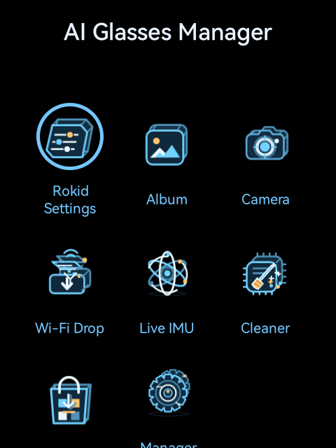
  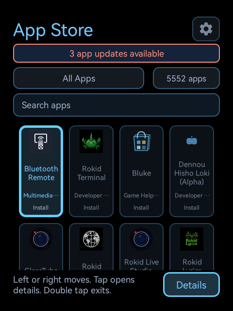
  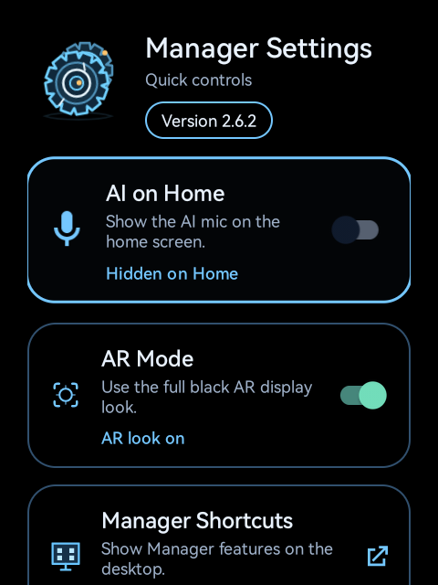
</p>

## What’s new in 2.6.3

- **Three camera filters:** Matrix, Cyber Glitch and Prism. Capture photos and video, and choose a filter style in Camera.
- **APK uploads and installation:** Upload APK files with Wi-Fi Drop, then open them in File Explorer on the glasses to install them. Supported apps can also be installed from the App Store.
- **Wi-Fi Drop improvements:** A redesigned browser interface and fixes to transfer reliability.
- **Clearer Camera controls:** Improved interface readability.

Read the [2.6.3 feature guide](https://phantom-not.github.io/ai-glasses-manager-releases/updates/2.6.3/) or the [original GitHub release notes](https://github.com/Phantom-Not/ai-glasses-manager-releases/releases/tag/v2.6.3).

## A full Android App Store alongside Rokid developer apps

Manager’s built-in App Store brings together **thousands of Android app listings**, with curated, developer, global and China-friendly selections. The dedicated Rokid developer collection is one part of that wider catalogue.

- Search for apps and browse categories.
- Read app details and check available download options.
- Pause, resume or cancel downloads, and let downloads continue in the background.
- Install supported APKs on the glasses.
- See available updates for supported installed apps.
- Keep browsing previously loaded information when offline.

The selection changes with available sources. Android app compatibility depends on the app and glasses, and some listings require an external store. The [App Store guide](https://phantom-not.github.io/ai-glasses-manager-releases/app-store/) explains the options.

## Camera filters, photo and video tools

Choose from **Matrix**, **Cyber Glitch** and **Prism** camera filters. Use photo and video modes, adjust zoom and framing, show grid controls, and configure shutter or recording sounds. Visual feedback confirms capture success or failure.

Album lets you browse photos and videos, view pictures, play video and delete media directly on the glasses. Read the [camera and filter guide](https://phantom-not.github.io/ai-glasses-manager-releases/camera-filters/).

<p align="center">
  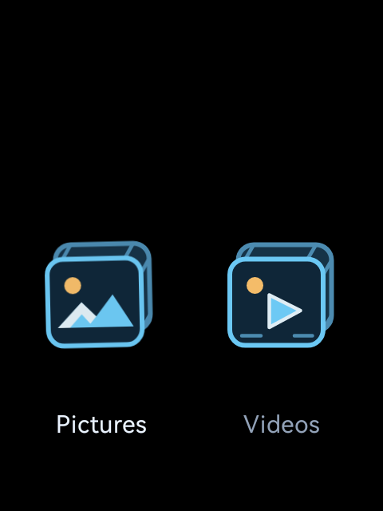
  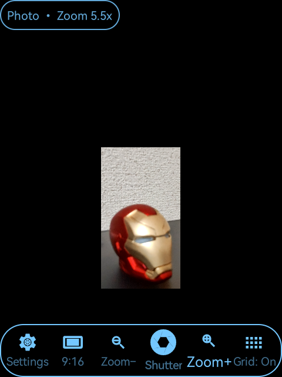
  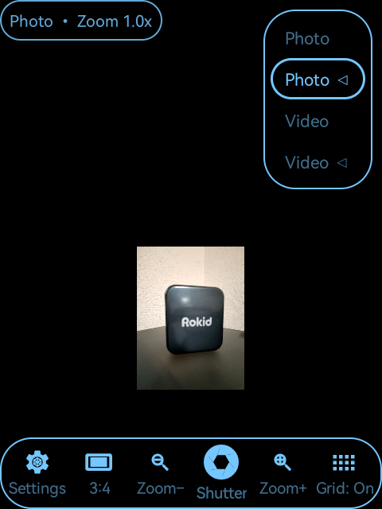
</p>

## Files, wireless transfers and APK installation

Browse local folders and open common files in File Explorer. Use **Wi-Fi Drop** to transfer files through a browser on a supported phone or computer, without connecting through ADB each time. Upload an APK, then open it from File Explorer to install it on the glasses.

See the [files and Wi-Fi Drop guide](https://phantom-not.github.io/ai-glasses-manager-releases/files/).

## Device controls, sound and tools

- Open Rokid and Android settings, including Wi-Fi, Bluetooth, keyboard, installed apps, storage and battery tools.
- Adjust system volume and glasses volume separately, use volume locking and configure swipe feedback.
- Use Cleaner for one-tap maintenance or to review running apps.
- View compass, accelerometer, gyroscope, pitch and roll information in Live IMU, with calibration and zeroing controls.
- Show or hide the optional AI microphone control. The built-in command guide includes supported English and Chinese examples.
- Add optional Camera, Album, App Store and File Explorer shortcuts to the Rokid launcher.
- Use AR Mode and check future Manager releases from Manager Settings > App Update.

<p align="center">
  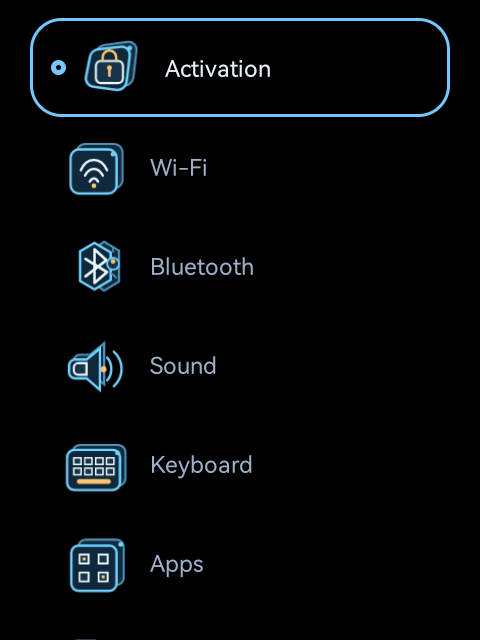
  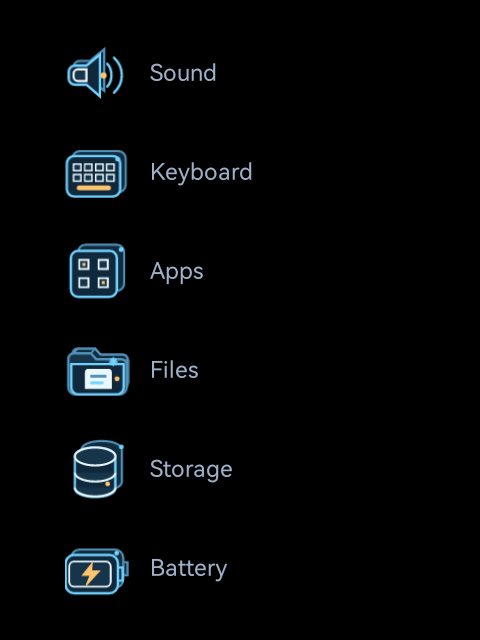
  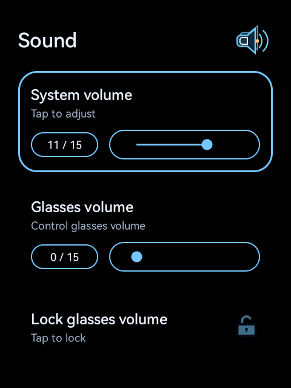
</p>
<p align="center">
  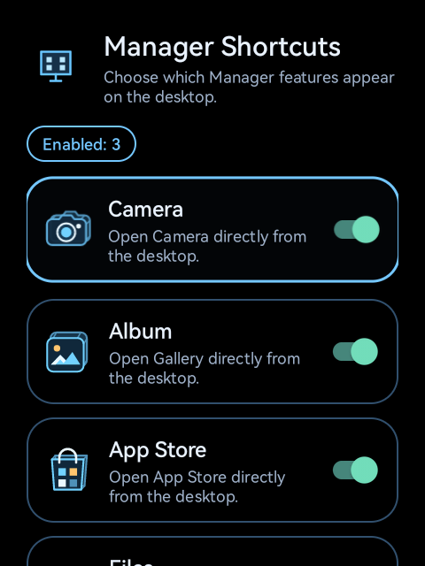
  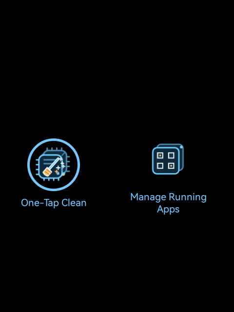
  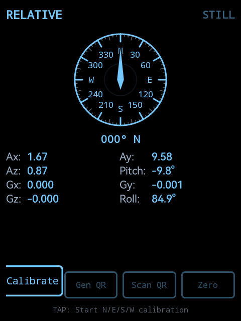
</p>

## Languages and compatibility

The current public interface supports **English, Simplified Chinese, Traditional Chinese, Cantonese (Hong Kong), Japanese, Korean, Russian, French, German and Spanish**. Interface language and voice-command support are different things.

Manager is designed and tested for Rokid Glasses and requires Android 8.0 or later. Available system actions can vary with glasses firmware and Android version.

## Pricing, activation and installation

There is a **three-day free trial**. Afterwards, activation costs **$1.99 per device, paid once**, with no recurring subscription. International payments use Stripe.

Install and activate Manager on the glasses you want to use. Your phone can open the checkout associated with the glasses’ activation page. Activating a separate copy of the app installed on your phone does not also activate the glasses.

Activation is normally restored after reinstalling on the same device. A factory reset may need a private support review. Please do not post receipts, activation details or device identifiers in public issues.

Download from the [official release page](https://github.com/Phantom-Not/ai-glasses-manager-releases/releases/latest) or an official mirror listed in [manager-update.json](manager-update.json). Use the Android package installer or a connected computer for the initial installation:

```text
adb install -r AI-Glasses-Manager-2.6.3.apk
```

Then open Manager from the Rokid launcher. The [installation guide and FAQ](https://phantom-not.github.io/ai-glasses-manager-releases/help/) cover device activation, updates and common questions.

## What’s next

I’m working on easier language switching, more camera features and further stability improvements for **2.6.4**. These changes are still in development. Full details will follow when the update is released.

## Feedback and support

[Open an issue](https://github.com/Phantom-Not/ai-glasses-manager-releases/issues) with your Manager version, glasses model and firmware, what you were doing, and the steps to reproduce the problem. Remove personal files, network details and device identifiers from screenshots. Contact Bruce privately for purchase or activation details.

[English product guide](https://phantom-not.github.io/ai-glasses-manager-releases/) · [中文功能说明](https://phantom-not.github.io/ai-glasses-manager-releases/zh/) · [日本語ガイド](https://phantom-not.github.io/ai-glasses-manager-releases/ja/) · [Version history](https://phantom-not.github.io/ai-glasses-manager-releases/updates/) · [Update feed](https://phantom-not.github.io/ai-glasses-manager-releases/updates/feed.xml)
